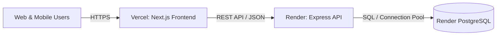

# EssenShare Production Deployment Guide

This guide details how to deploy the **EssenShare API** on **Render** and the **Next.js Frontend** on **Vercel**.

---

## 1. Architecture Overview



- **Frontend**: Next.js 14 (App Router) on Vercel Edge / Serverless Network
- **Backend API**: Node.js 20 + Express on Render Web Service
- **Database**: Managed PostgreSQL with PostGIS extension enabled on Render (or Neon / Supabase)

---

## 2. Backend Deployment on Render

### Method A: Blueprint Deployment (Recommended — 1 Click)

1. Push your code to your GitHub/GitLab repository.
2. Log in to [Render](https://dashboard.render.com/).
3. Click **Blueprints** → **New Blueprint Instance**.
4. Select your repository. Render will automatically read [`render.yaml`](../render.yaml) and create:
   - **`essenshare-db`**: Managed PostgreSQL database.
   - **`essenshare-api`**: Web service running `backend/` with auto-migrations.
5. In the blueprint review:
   - Fill in `APP_URL` with your frontend URL (e.g., `https://essenshare.vercel.app`).
   - Click **Apply**.

### Method B: Manual Web Service Setup

If configuring manually without Blueprints:

1. In Render Dashboard, click **New +** → **PostgreSQL**:
   - **Name**: `essenshare-db`
   - **Database**: `surplus_prod`
   - **User**: `surplus_admin`
   - **Plan**: Free (or Starter)
   - Copy the **Internal Database URL**.
2. Click **New +** → **Web Service**:
   - **Repository**: Select your repo
   - **Root Directory**: `backend`
   - **Runtime**: `Node`
   - **Build Command**: `npm ci --omit=dev && npm run db:migrate`
   - **Start Command**: `node src/server.js`
   - **Health Check Path**: `/health`
3. Add Environment Variables:
   | Variable | Value |
   |---|---|
   | `NODE_ENV` | `production` |
   | `PORT` | `10000` |
   | `DATABASE_URL` | *(Paste Internal Database URL from step 1)* |
   | `JWT_ACCESS_SECRET` | *(Generate 32+ character random secret)* |
   | `JWT_REFRESH_SECRET` | *(Generate 32+ character random secret)* |
   | `APP_URL` | `https://your-frontend.vercel.app` |
   | `CORS_ORIGIN` | `https://your-frontend.vercel.app` |

---

## 3. Frontend Deployment on Vercel

1. Log in to [Vercel](https://vercel.com/) and click **Add New...** → **Project**.
2. Import your EssenShare repository.
3. Configure Project Settings:
   - **Framework Preset**: `Next.js`
   - **Root Directory**: Click *Edit* and select `frontend` (or leave default if using root [`vercel.json`](../vercel.json)).
   - **Build Command**: `npm run build`
   - **Output Directory**: `.next`
   - **Install Command**: `npm ci`
4. Configure Environment Variables:
   | Variable | Value | Description |
   |---|---|---|
   | `NEXT_PUBLIC_API_URL` | `https://essenshare-api.onrender.com/api/v1` | URL of your deployed Render backend API |
   | `NEXT_PUBLIC_MAPBOX_TOKEN` | *(Optional)* | Mapbox access token for custom map vector tiles (falls back to Carto/OSM) |
5. Click **Deploy**.

---

## 4. Post-Deployment Verification

### 1. Backend Health Check
```bash
curl https://essenshare-api.onrender.com/health
# Expected: {"status":"ok","timestamp":"...","version":"1.0.0","environment":"production"}
```

### 2. CORS Verification
Test an OPTIONS preflight from the frontend origin:
```bash
curl -X OPTIONS https://essenshare-api.onrender.com/api/v1/donations \
  -H "Origin: https://your-frontend.vercel.app" \
  -H "Access-Control-Request-Method: GET" -I
# Expected: HTTP 204 with Access-Control-Allow-Origin matching your Vercel URL
```

### 3. Internationalization & PWA
- Visit your Vercel URL.
- Switch language via the navbar dropdown to German, Spanish, French, Arabic, etc.
- Verify that Footer, Navigation, PWA pill, and Proximity Alerts all display translated strings without fallback to English.
